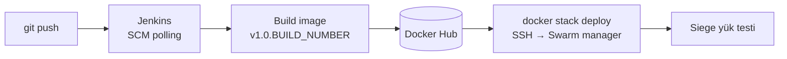

# Zero-Downtime Deployment — Jenkins · Docker Swarm · Siege


Django uygulamasını Jenkins pipeline'ı ile derleyip Docker Swarm cluster'ına **kesintisiz (zero-downtime)** dağıtan ve bunu canlı yük testiyle kanıtlayan bir CI/CD projesi.

## Pipeline



| Aşama | Ne yapar |
|---|---|
| Checkout | Repoyu çeker |
| Build Image | Multi-stage Dockerfile ile `v1.0.<build>` ve `latest` tag'li imaj |
| Push Image | Docker Hub'a credential ile güvenli login + push |
| Deploy to Swarm | `docker-stack.yml` ve `nginx.conf`'u manager'a kopyalar, stack'i günceller |
| Siege Test | Deploy sırasında 30 sn, 10 eşzamanlı kullanıcıyla yük testi |

## Kesintisizliği sağlayan ayarlar (`docker-stack.yml`)

- **3 replica** web servisi, `update_config`: `parallelism: 1`, `order: start-first`, `delay: 10s`
- **Healthcheck:** `/health` endpoint'i sağlıklı dönmeden yeni container trafiğe alınmaz
- **`failure_action: rollback`:** Sağlıksız sürüm otomatik geri alınır
- **Docker secrets:** DB parolası ve Django secret key imaja gömülmez, Swarm secret olarak verilir
- **Nginx** reverse proxy + overlay network, PostgreSQL kalıcı volume ile

## Sonuç

Rolling update sırasında Siege raporu:

| Metrik | Değer |
|---|---|
| Toplam istek | 11.371 |
| **Availability** | **%100,00** |
| Başarısız istek | **0** |
| Ortalama yanıt süresi | 0,03 sn |
| İşlem hızı | 381 istek/sn |

Ayrıntılı rapor: [`RAPOR.md`](RAPOR.md)

## Çalıştırma

```bash
docker swarm init
docker network create -d overlay django-overlay
printf '<parola>' | docker secret create db_password -
printf '<secret-key>' | docker secret create django_secret_key_v2 -
docker stack deploy -c docker-stack.yml my-django-stack
```
